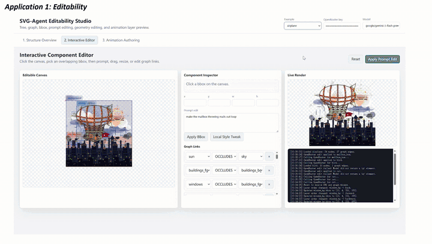
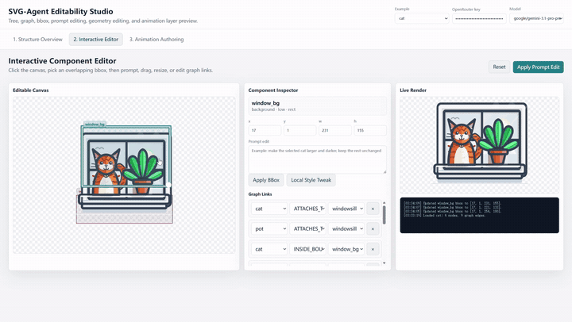
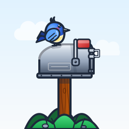
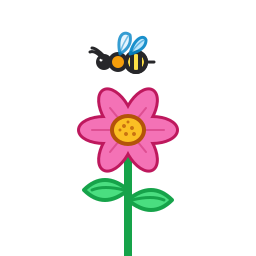
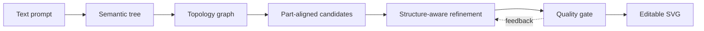

<div align="center">

# StructSVG

### Tree-Graph Guided Multi-Agent Text-to-SVG Generation

[](#)
[](https://www.python.org/)
[](https://www.w3.org/Graphics/SVG/)

**Accepted to SIGGRAPH Asia 2026**

StructSVG turns a text prompt into a structured, editable, and animation-ready
SVG through explicit tree-graph planning and coordinated specialist agents.

</div>

## 🎬 Demos

Click either preview to watch the compressed full video.

<table>
  <tr>
    <td width="50%" align="center"><strong>Method, results, and applications</strong></td>
    <td width="50%" align="center"><strong>Interactive component editing</strong></td>
  </tr>
  <tr>
    <td><a href="assets/videos/structsvg-overview.mp4"></a></td>
    <td><a href="assets/videos/structsvg-editor-demo.mp4"></a></td>
  </tr>
  <tr>
    <td align="center"><a href="assets/videos/structsvg-overview.mp4">▶ Watch overview video</a></td>
    <td align="center"><a href="assets/videos/structsvg-editor-demo.mp4">▶ Watch editor demo</a></td>
  </tr>
</table>

## 🧩 Generated SVGs

<p align="center">
  
  
  
</p>
<p align="center">
  
  
  
</p>

Every result remains vector-native: elements have stable IDs, component
relationships are explicit, and downstream editing, styling, and animation can
target individual parts.

## 🏗️ How it works

StructSVG separates planning from drawing and refinement:

1. **Tree-Graph Planning** — a semantic decomposer builds a part hierarchy,
   then a topology planner adds spatial relations such as attachment,
   containment, and occlusion.
2. **Part-Aligned SVG Drafting** — a component drafter generates multiple SVG
   candidates whose element IDs follow the planned semantic structure.
3. **Structure-Aware Refinement & Selection** — a refiner improves individual
   components and global composition, while a quality gate combines static
   checks, LLM review, CLIP, and optional HPSv2 signals.



The released runtime uses four roles: a thin **Coordinator**, **TreeBuilder**,
**SVG Engineer**, and **Critic**. It also includes candidate manifests,
structural-drift checks, retry diagnosis, prompt optimization and rollback,
cross-task memory, and ablation controls.

## 🚀 Quick start

### 1. Install

```bash
git clone https://github.com/sealost/StructSVG.git
cd StructSVG
python -m venv .venv
source .venv/bin/activate  # Windows: .venv\Scripts\activate
pip install -r requirements.txt
playwright install chromium
```

### 2. Configure the model API

StructSVG uses an OpenAI-compatible OpenRouter endpoint. Keep credentials in
the environment:

```bash
export OPENROUTER_API_KEY="your-key"
export STRUCTSVG_MODEL="gemini-3-flash-preview"
```

PowerShell:

```powershell
$env:OPENROUTER_API_KEY = "your-key"
$env:STRUCTSVG_MODEL = "gemini-3-flash-preview"
```

### 3. Generate an SVG

```bash
python structsvg.py \
  --task "A stylized fox running through geometric grass" \
  --results_dir results
```

The final SVG and its metadata are written to `results/`. Runtime state lives
under `.workspace/`; published candidates are staged in `generated_svgs/`.

### Batch generation

```bash
python structsvg.py --jsonl examples/prompts.jsonl --results_dir results
```

## 📊 Optional CLIP + HPSv2 scoring

The pipeline runs without the local scorer and falls back gracefully. To use
the paper's visual reward path:

```bash
pip install -r requirements-score.txt
python score_service.py
```

By default, the scorer loads `models/clip/` when present or downloads
`openai/clip-vit-base-patch32`. Optional HPSv2 weights belong in
`models/hpsv2/`. Override the defaults with `STRUCTSVG_CLIP_MODEL`,
`STRUCTSVG_SCORER_HOST`, `STRUCTSVG_SCORER_PORT`, or
`STRUCTSVG_SCORER_URL`.

## 🧪 Ablations and controls

| Argument | Options | Purpose |
| --- | --- | --- |
| `--generation_mode` | `one_shot`, `autoregressive` | Full SVG or node-by-node drafting |
| `--reward_ablation` | `full`, `no_clip`, `no_hps`, `no_clip_no_hps`, `llm_only` | Select quality signals |
| `--no_textgrad` | flag | Disable prompt-gradient refinement |
| `--max_turns` | integer | Cap agent interactions per task |
| `--debug` | flag | Save per-turn Markdown traces |
| `--clean` | flag | Clear runtime folders while preserving results and models |

## 📁 Repository layout

```text
StructSVG/
├── structsvg.py                  # complete multi-agent pipeline
├── score_service.py              # optional CLIP/HPSv2 service
├── combine_logs.py               # debug-trace utility
├── examples/prompts.jsonl        # batch input examples
└── assets/
    ├── gallery/                  # editable SVG examples
    ├── previews/                 # lightweight README animations
    └── videos/                   # compressed full demos
```

## 📝 Release notes

This initial release packages the most complete author snapshot found during
the code audit. It contains the runtime prompt-rewrite and rollback path that
was absent from the earlier server prototype. Machine-specific caches, model
weights, experiment logs, and credentials are excluded.

The current implementation is a research prototype centered on a single
Python pipeline. API responses and visual scoring can introduce run-to-run
variation. Repository-level licensing and the final paper citation will be
added by the maintainers.
